# How many steps? The step counter

A small neural network, written in PyTorch, that counts steps (both feet) from the ankle IMU, and a distance estimate built on top of it.

## The idea in four lines

1. The IMU sends 8 numbers every 10 ms (acceleration and rotation on three axes, plus their totals).
2. Five layers of 1-D convolution, each looking at neighbouring moments of that signal, turn them into **one number per moment: how many steps are happening right now** (a step density, never negative).
3. **Add the density up over a trial and you have the step count.**
4. Training only needs the number you counted for each trial. There is no label saying *where* each step is. The loss is how far the sum is from your count (on a log scale), so the network has to discover what a step looks like, and that standing, a tapping foot and air-biking are not steps.

```
signal --> conv --> ReLU --> conv --> ReLU --> conv --> ReLU --> conv --> ReLU --> conv --> ReLU --> 1x1 conv --> softplus --> density
 (8 x time)                                                                                                     (1 x time)
loss = | ln(1 + sum(density)) - ln(1 + steps you counted) |      backpropagation + Adam update every weight
```

About 6000 weights, a receptive field of 125 readings (1.25 s). Training is on whole trials, with augmentations that cannot change the step count: the sensor tilted a few degrees, a different strength, the same steps faster or slower, more noise.

## How it works, illustrated

### The system

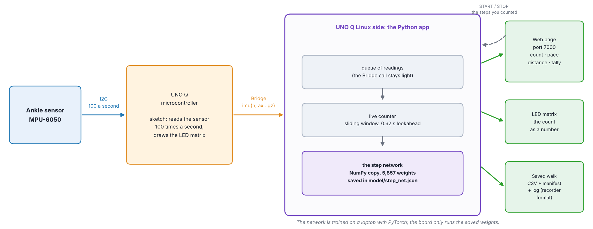

The sensor is on the ankle. The sketch on the microcontroller reads it 100 times a second and sends each reading over the Bridge. The Python app on the Linux side only queues readings in that callback; five times a second it hands the new ones to the live counter, which runs the network on a sliding window of the signal and adds up its output. The count goes to the web page and, as a number, to the LED matrix, and every walk is saved in the step recorder's format. The network is trained on a laptop with PyTorch; the board only runs the saved weights (the same arithmetic in NumPy).

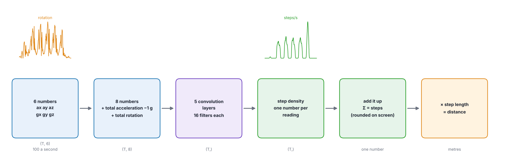

### What the network sees

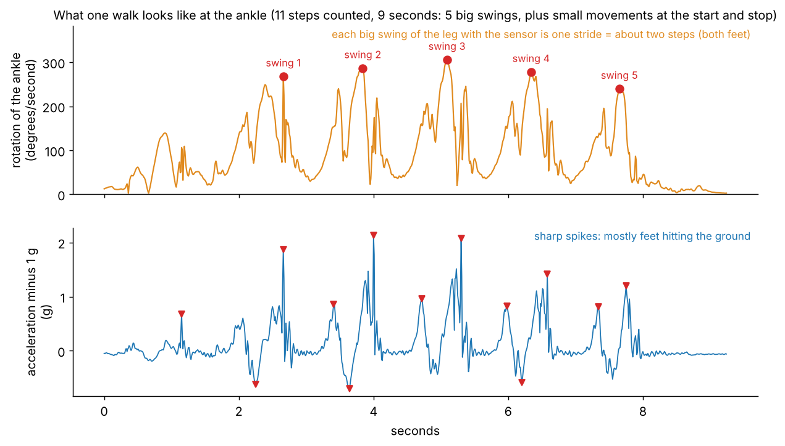

The rotation of the ankle rises once per stride of the leg with the sensor, and the acceleration shows sharp spikes when a foot hits the ground. The network is not told any of this. It also cannot rely on a clean pattern: there are small movements at the start and stop, and the strides are not identical.

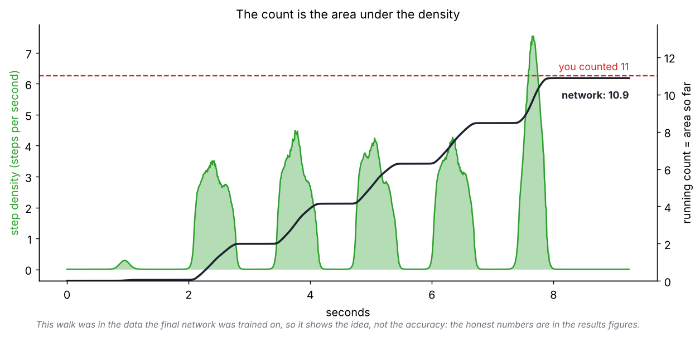

At every reading the network outputs one number: how many steps are happening right now (a step density, never negative). **Adding the density up over the walk gives the count**, for both feet, without assuming "twice the strides". Nothing marks where the steps are: the only label is the count you typed for the trial. (This walk was in the data the final network was trained on, so the figure shows the idea; the honest accuracy is in the results below.)

### Architecture

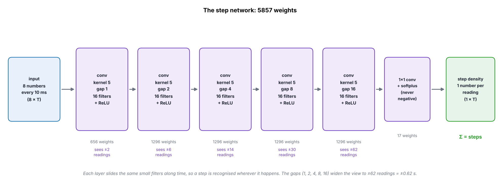

| Layer | Reads | Output | Weights |
|---|---|---|---|
| conv, kernel 5, gap 1 + ReLU | 8 numbers | 16 | 656 |
| conv, kernel 5, gap 2 + ReLU | 16 | 16 | 1,296 |
| conv, kernel 5, gap 4 + ReLU | 16 | 16 | 1,296 |
| conv, kernel 5, gap 8 + ReLU | 16 | 16 | 1,296 |
| conv, kernel 5, gap 16 + ReLU | 16 | 16 | 1,296 |
| 1×1 conv + softplus | 16 | 1 (the density) | 17 |
| **Total** | | | **5,857** |

A convolution slides the same small filters along time, so a step is recognised wherever it happens in the walk, with far fewer weights than a network that treats every moment separately. The widening gaps ("dilation") let the stack see a whole stride:

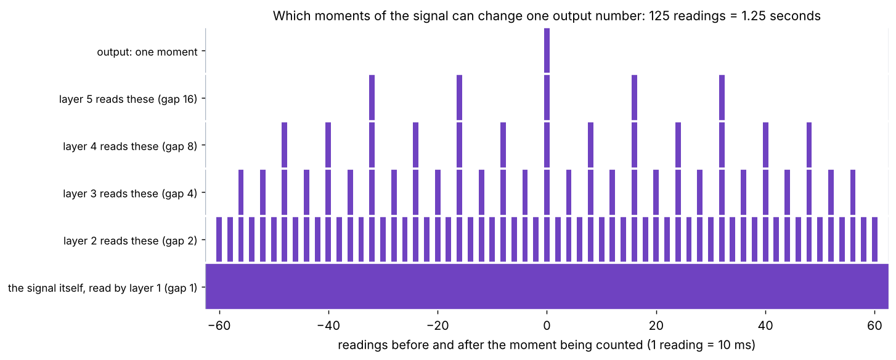

Five ordinary kernel-5 layers would see only ±10 readings (0.1 s on each side). With gaps 1, 2, 4, 8 and 16 the same five layers see ±62 readings (0.62 s on each side), 1.25 s in all, which is long enough to contain a stride. The network is small on purpose: with 55 trials, a large one would have enough weights to memorise them.

### Training

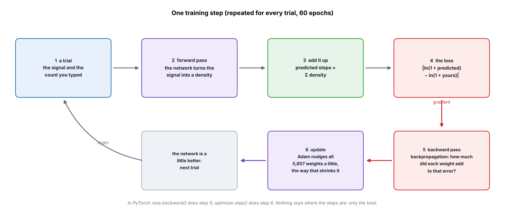

For every trial the network turns the signal into a density, the density is summed into a predicted count, and the loss measures how far that is from the count typed in the recorder, on a log scale: `|ln(1 + predicted) - ln(1 + counted)|`. Backpropagation (`loss.backward()` in PyTorch) works out how much each of the 5,857 weights contributed to that error, and Adam (`optimizer.step()`) nudges every weight a little in the direction that shrinks it. Settings: 60 epochs, batches of 4 trials, learning rate 3e-3 with a cosine schedule, weight decay 1e-4, seed 0.

Each epoch uses a fresh version of every trial, changed in ways that cannot change the number of steps: the sensor tilted a few degrees, a different overall strength, the same steps made faster or slower (the walk is stretched in time), and a little more noise. Standing, foot-tapping and, from the older recordings, air-biking have 0 steps, so the network also learns what is not a step.

### Counting while you walk

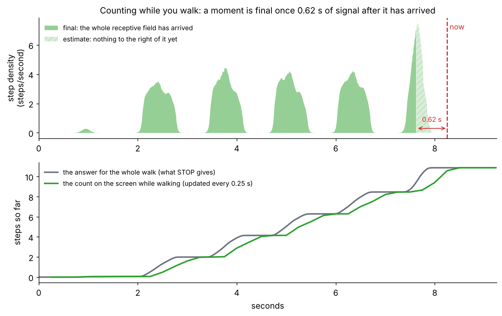

The network looks 0.62 s ahead of every moment, so a moment is only final once 0.62 s of signal after it has arrived. The live counter therefore shows the exact count up to 0.62 s ago plus an estimate for the last 0.62 s, and the screen's number can change by a little as readings arrive. Pressing STOP makes everything final, and the result equals the offline count of the whole walk (the tests check this to nine decimals in the counter itself, and to 0.01 steps on real trials streamed through the app one reading at a time, since the app stores the count to two decimals).

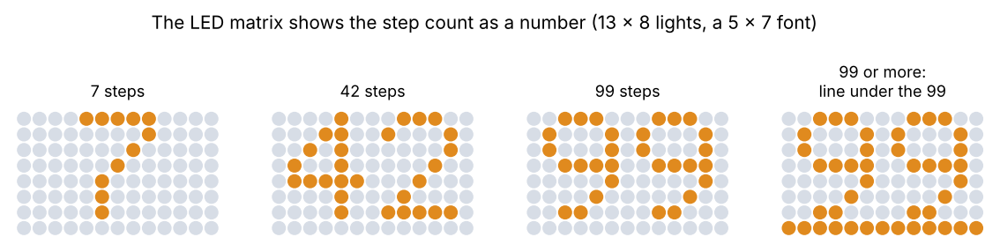

The board also shows the count as a number on the LED matrix (a 5×7 font, two digits; 99 or more shows 99 with a line under it).

## Use it

```
pip install -r requirements.txt                        # on Windows and Mac the default torch should be the CPU build; that is all this needs
python train_steps.py --trials all_trials.zip          # the zip from the step recorder; about 10 minutes (60 epochs)
python train_steps.py --trials all_trials.zip --quick  # a rougher run in about 2 minutes, to check everything works
python run_all_tests.py
```

`train_steps.py` loads the trials, tests the network against a classical peak-counting baseline with **cross-validation** (every trial is predicted by a network that never saw it), repeats the test on a **new person** when there are two, estimates **distance** (steps times a step length fitted to the measured walks, tested the same honest way), trains the final network, and writes:

| Output | What it is |
|---|---|
| `models/step_net.json` | the trained network as plain numbers; `steps_numpy.py` runs it with no PyTorch (the board uses this) |
| `models/step_net.pt` | the same weights for PyTorch |
| `models/distance.json` | the step-length model |
| `results/summary.md` | every number with its uncertainty, and the limits |
| `results/*.png` | predicted against counted steps, the errors, network against baseline, example trials, training loss, distance |
| `results/results.json` | every trial's out-of-fold prediction |

**Every decision in one table:**

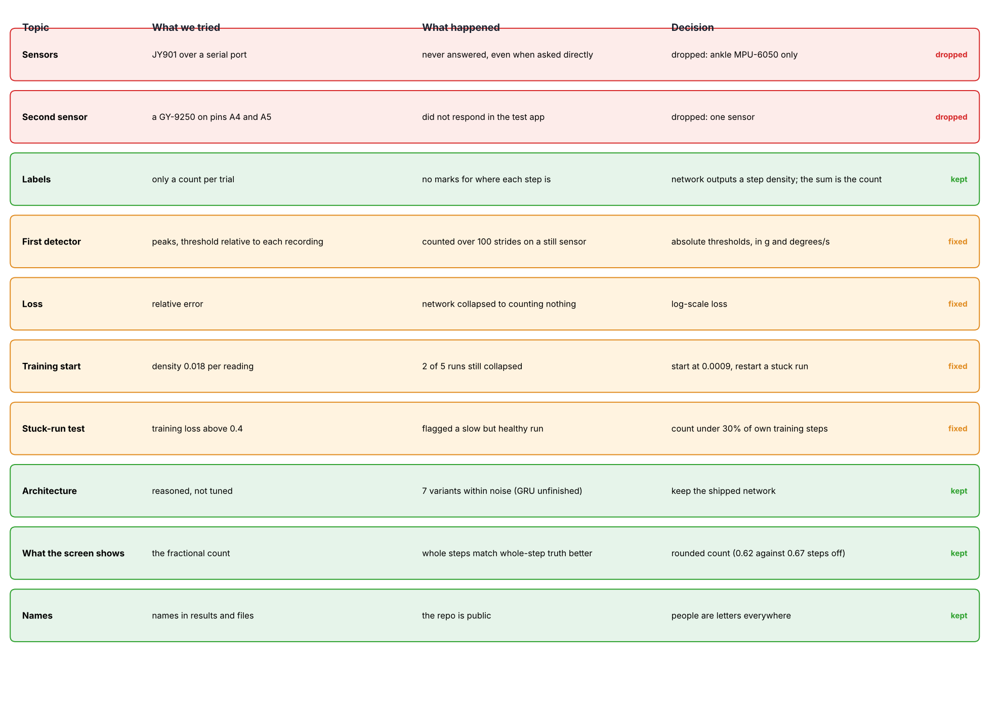


## The live counter

`apps/gait-steps-live/` is an Arduino App Lab app that counts steps while you walk: the count goes on a web page and on the board's LED matrix as a number. It runs the NumPy copy of the network (no PyTorch on the board). After each walk you type the steps you really counted, and it keeps a running tally of how right it was. Every walk is saved in the step recorder's format, so `train_steps.py` can read the demos back in as training data. See `apps/gait-steps-live/README.md`.

After retraining, copy the new network into the app with `python sync_live_app.py` (`python sync_live_app.py --check` says whether the app's copy is stale; the tests fail if it is).

## Files

```
steps_data.py       load the recorder's zip; the 8 numbers the network reads
steps_model.py      the PyTorch network, the augmentations, the loss, the training loop
steps_numpy.py      the same network in NumPy
steps_live.py       counting while walking: exact once 0.62 s of signal after a moment has arrived
steps_baseline.py   the classical counter (peaks above an absolute threshold)
steps_distance.py   step length from cadence, with leave-one-out error
steps_eval.py       cross-validation, error statistics, bootstrap intervals
steps_plots.py      the figures
synth.py            made-up trials with a known right answer, for the tests only
steps_export.py     step-length models (everyone, and each person) and the accuracy card the live app shows
steps_alt.py        other architectures (narrow, wide, shallow, deep, other kernel sizes, a GRU), only for the comparison
arch_compare.py     does the architecture matter? the same cross-validation for each, with a rule fixed beforehand
export_live_assets.py  rewrite distance.json and evaluation.json from an existing network, without retraining
sync_live_app.py    copy the NumPy network and its models into apps/gait-steps-live
apps/gait-steps-live/  the live counter (an App Lab app)
docs/images/       the illustrations; docs/make_images.py draws them (python docs/make_images.py --trials all_trials.zip)
docs/architecture_comparison_numbers.json   the numbers behind the comparison table, with where they came from
train_steps.py      the command above
tests/              what the tests check is in tests/README.md
```

## Results on the real trials

55 trials from two people (10.5 minutes, 490 steps counted), called A and B here (names are replaced by letters everywhere in this project). Every number is out-of-fold: each trial predicted by a network that never saw it. The truth is the count typed in the recorder, good to about a step or two.

| | Network | Classical baseline |
|---|---|---|
| Average error, steps (95% interval) | **0.67** (0.47 to 0.89) | 0.76 (0.47 to 1.13) |
| Average error on the 41 trials with steps only | 0.89 | 0.78 |
| Steps counted on the 14 trials with no steps (standing, foot tapping) | 0.0 on average, 0 at worst | 0.7 on average, 8 at worst |
| Trials within 1 step | 75% | 91% |
| Worst trial, steps off | 2.8 | 8.0 |
| Trained without person A, tested on A (steps off) | 1.19 | 0.71 |
| Trained without person B, tested on B (steps off) | 1.16 | 3.04 |

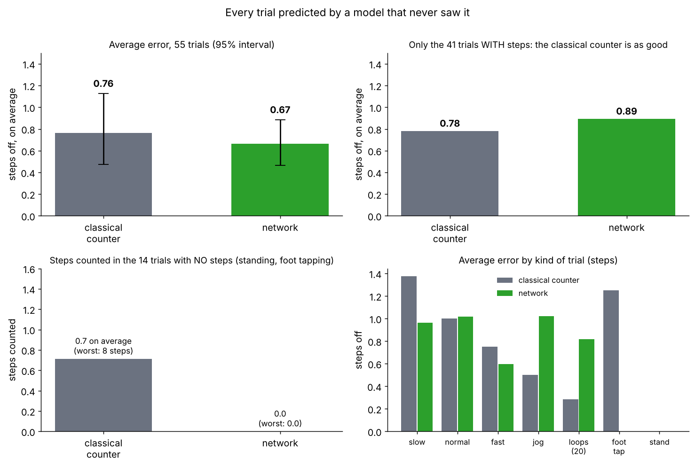

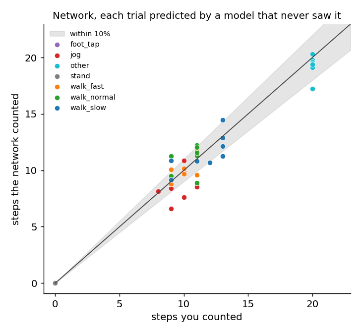

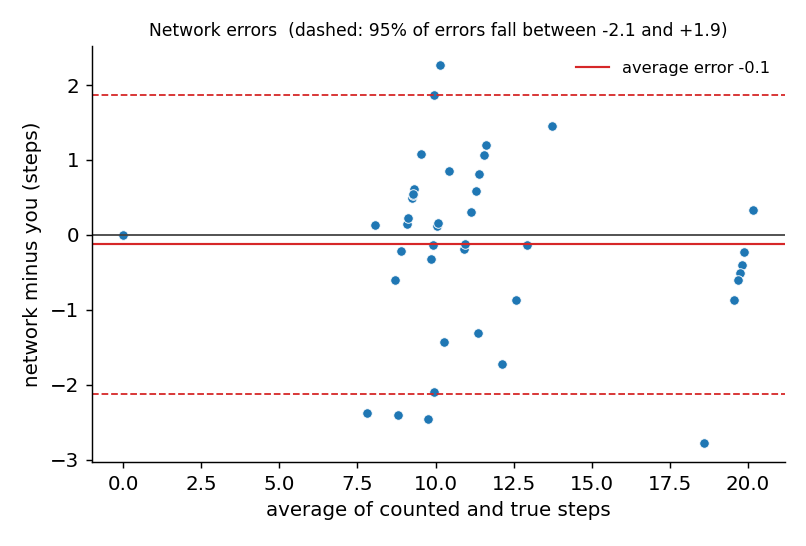

A typical trial, and the worst one (the density has one bump per leg swing of about two steps each, and the missing steps are small movements at the turns that barely show in the signal):

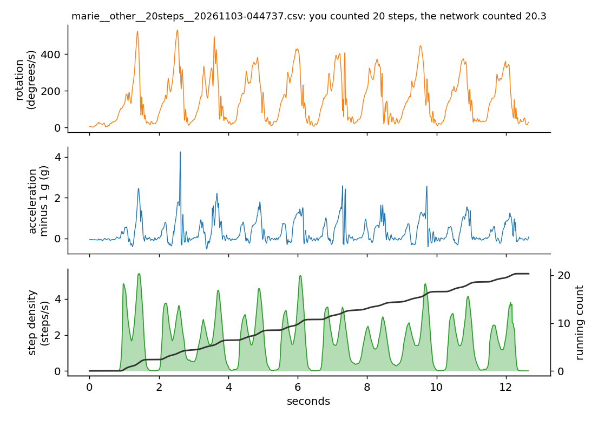

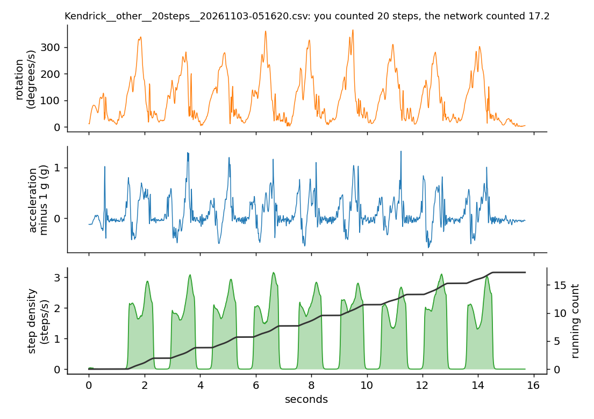

Read this honestly: **on trials with steps, the classical counter is about as good as the network** (slightly better on average, and better at being within 1 step). The network's overall edge comes from the no-step trials: it counted nothing on all of them, while the classical counter counted false steps on two foot-tapping trials. It also carries over to a new person more evenly (about 1.2 steps either way, against 0.7 and 3.0). It under-counts jogging by about 2 steps in some trials.

**Distance.** Steps times a step length fitted to the measured walks: about 11.5% off end to end with one model for both people, 7.2% off when calibrated on person A's own walks, and 15.3% for person B, whose step counts did not track the distance as consistently (13 steps for both the 4.8 m and the 5.8 m line). The walks were only 4.8 to 5.8 m long, so one step out is about a 10% error on its own.

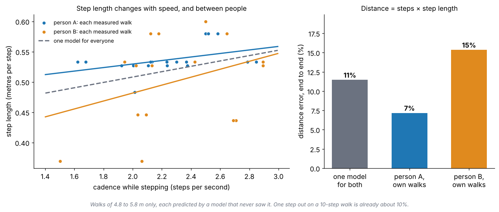

The training fix described below was chosen by looking at random splits of these same trials, so these numbers are slightly optimistic. `results/FIRST_RUN_BEFORE_THE_FIX.md` records the first run, before the fix, when training collapsed.

## Does the architecture matter?

The architecture was reasoned from the problem, not chosen by testing alternatives. Afterwards a sensitivity check was run, with a rule fixed **before** any result was seen: *the shipped architecture stays unless another variant is better by at least 0.15 steps and the 95% interval of the paired difference lies entirely below zero.* Each variant was trained and tested exactly like the shipped network (the same five folds, 60 epochs, loss, augmentation, starting density, restart guard and extra negatives); only the architecture changed.

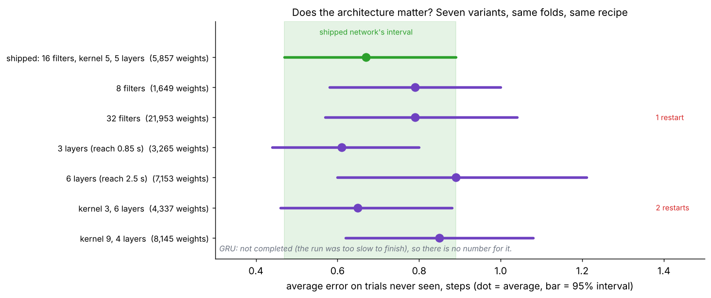

| Variant | Weights | Average error, steps (95% interval) | Runs that needed a restart |
|---|---|---|---|
| **shipped**: 16 filters, kernel 5, 5 layers | 5,857 | 0.67 (0.47 to 0.89) | 0 of 5 |
| 8 filters | 1,649 | 0.79 (0.58 to 1.00) | 0 of 5 |
| 32 filters | 21,953 | 0.79 (0.57 to 1.04) | 1 of 5 |
| 3 layers (reach 0.85 s) | 3,265 | 0.61 (0.44 to 0.80) | 0 of 5 |
| 6 layers (reach 2.5 s) | 7,153 | 0.89 (0.60 to 1.21) | 0 of 5 |
| kernel 3, 6 layers | 4,337 | 0.65 (0.46 to 0.88) | 2 of 5 |
| kernel 9, 4 layers | 8,145 | 0.85 (0.62 to 1.08) | 0 of 5 |
| bidirectional GRU | | **not completed** | |

What this does and does not say:

- The largest improvement over the shipped network is 0.06 steps (3 layers), far under the 0.15 the rule needs, so by the rule none beats it. The wider, deeper and larger-kernel variants look slightly worse, but every interval overlaps the shipped network's: with this few trials the data cannot tell these designs apart.
- **The GRU is missing.** Its run was too slow on the one CPU core available (it trains one trial at a time) and did not finish, so a recurrent network was not compared. `python arch_compare.py --trials all_trials.zip --variants gru --resume` would run it, and takes well over half an hour on one core.
- The numbers above were copied from the run's log (two decimals). The per-trial predictions of that run were not kept, so the paired intervals the rule calls for were never computed; the conclusion rests on the simpler fact that no variant came within reach of the 0.15 margin.
- Two variants (32 filters, and kernel 3) had training runs that collapsed and were restarted by the guard described in the next sections (1 and 2 of 5 runs); the shipped network needed no restarts.

## Things that went wrong, and what fixed them

**1. The first loss function.** The first loss was the relative error, `|counted - true| / (true + 5)`. On made-up trials with a known answer the network **collapsed**: it learned to count nothing at all, so every walk was predicted as 0.0 steps. On a trial with no steps, one early false step cost 12 times as much as missing steps on a walk, so the cheapest thing was to output zero everywhere, and a softplus that far below zero has almost no gradient to climb back out. The log loss above keeps a false step expensive but bounded, and the same test then gave 6% error, 0.84 steps on average and no false steps on the 0-step trials. A higher learning rate (6e-3) was unstable, so it stays at 3e-3. The test that would catch this again is in `tests/test_steps.py` (section 11).

**2. Training that still got stuck, on the real trials.** With the log loss, training still collapsed to "count nothing" in 2 of 5 runs on the real recordings (the final training loss was 1.1 instead of 0.06, and the network counted 0% of the true steps). The cause was the starting point: the density began at 0.018 steps per reading, which is 36 false steps in a 20-second trial with no steps, so the early updates turned everything down, and a softplus far below zero has almost no gradient to come back up. Starting at 0.0009 per reading (`INIT_BIAS = -7`) removed it: 0 of 5 collapses, and the average held-out error on those splits fell from 3.9 to 0.6 steps. As a safety net, a run whose network counts less than 30% of the true steps on its own training walks is discarded and restarted with another seed, and the summary reports how often that happened (the training loss is not used for this: a healthy run can still be improving slowly). The test is section 11b.

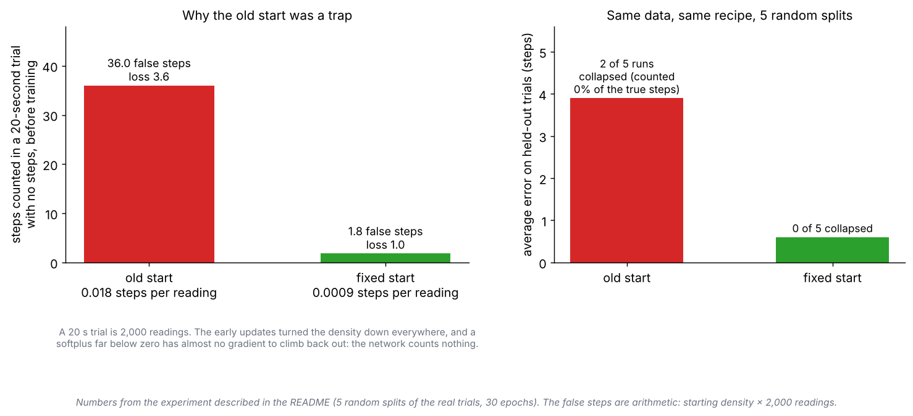

## Limits

- The truth is the count you typed, good to about a step or two.
- A few dozen trials from one or two people: read the intervals in `summary.md`, not just the averages.
- The sensor must sit the same way on the same ankle, on the kind of walking that was recorded. Stairs, slopes, carrying things and other shoes were not tested.
- Step length depends on speed and on the person, and distance error grows with distance.
